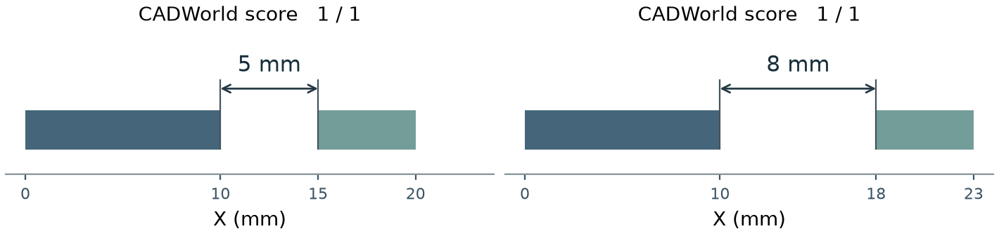

# AI-CAD 的“通过”究竟保证了什么？

DBCAD 科研记录 · P0 选题交付与 P0.5 反例核验 · 2026 年 11 月 24 日

## 选题决定

**建议进入小规模 P1。** 我们已经复现了一道真实考题里的漏检。题目要两个面的距离为 5 毫米，交上一份 8 毫米的原生装配，现行评分程序也给了满分。我们还查了另一条线索：换一种方式合并专家分数，在 770 份完整作品中只改变了 1 份的结论。[CADWorld 原题与启用规则](https://github.com/Zdong104/CADWORLD/blob/5e9529ff984b5426a5c194b94a09dc84cbe7fa7a/evaluation_examples/examples/assemble/freecad-assemble-003.json) · [neuralCAD-Edit 原始数据](https://huggingface.co/datasets/autodesk/neuralCAD-Edit/tree/b29220c3ccceecd9188ab42f1688e4e6bf5d7a7d)

**值得研究的问题**是，在 CAD 生成和编辑的公开考题里，用户已经说清的哪些工程要求，会出现“答案违反了它，测试仍放行”？同一件事也要反过来问，换一种合规做法，测试会不会错杀？第一种错误已有一例。第二种是 P1 要检验的假设。

| 要问的问题 | 可以观察什么 | 本轮判断 |
| --- | --- | --- |
| 这个零件能作为几何实体使用吗？ | 实体能否重建、拓扑是否合法 | 能过这关的零件仍可能做错尺寸。承载、配合、公差各需相应的证据。 |
| 它完成了这一次委托吗？ | 指定零件、尺寸、连接关系，以及编辑时承诺保护的部分 | 有明确要求时，可以用原生模型独立量，再与判卷结果对照。 |
| 下一位工程师拿到它要做什么？ | 改参数、换规格、交付制造或继续装配 | 是否需要测这些行为取决于交付约定。笼统写“工程上可用”，无法确定具体该做哪次试验。 |

**P0 的边界。** 现实需求有文献依据，测量漏检也有可复现的办法。“给 CAD 写程序验收”已经有很接近的工作。一道公开题的缺项足以启动实验，论文所需的跨题重复性、独立效用和新颖性仍待检验。工程师修改和复用 CAD 的实证研究也支持把“接手后做什么”写入交付条件。[Camba 等的 CAD 复用研究](https://www.sciencedirect.com/science/article/pii/S0010448516000051)

## 已有的验收方法做到了哪一步？

**neuralCAD-Edit 已给出可复算的验收定义。** 10 位专家提供 192 条编辑请求和 384 件人工编辑。评测时，专家看到请求、六个正投影视图和一个轴测图，分别给“指令满足度”和“模型质量”打 1 至 7 分。按论文协议，每件由五人评，两项各取中位数，均达到 5 分即验收通过。成组作品报告通过比例。如何从证据给每一项打分，仍用专家量表判断。按量表，5 分可以容纳轻微问题。[§4.2、表 1 和附录 B](https://arxiv.org/html/2604.16170v1#S4.SS2)

表 1 中，GPT-5.2 的有效模型比例为 **99%**，专家验收率为 **25%**。另一位人类编辑者分别为 **100%** 和 **78%**。有效模型比例描述得到有效 CAD 输出的情况，未逐项验证制造、公差或受力。这组数据支持“能输出，还可能交错货”。两个总体比例没有给出逐件失败原因。若要声称两种通过集合必然包含，须由协议明确设置硬门槛，或用逐件交叉表检验这批数据。[neuralCAD-Edit 表 1](https://arxiv.org/html/2604.16170v1#S4.T1)

| 工作 | 实际检查什么 | 给我们留下的边界 |
| --- | --- | --- |
| AgenticCADedit | 沿用两项门槛，由 Claude Code 中的 Opus 5 medium 查看渲染评分。Qwen3.6-27B 的有效率从 51.0% 升到 94.8%，视觉模型验收率从 1.6% 升到 12.0%。 | 这些数值对应视觉模型评分，未在本轮重新做五人专家评审。[§6、表 3](https://arxiv.org/html/2609.29621v1#S6) |
| CADTestBench | 将生成要求拆成 B-Rep 上可运行的测试。用故意改坏的候选改进测试，允许合规变体、返回失败信息。125 件生成结果的两名标注者互评 κ 为 0.54，与共识标签对照的程序准确率为 0.938、F1 为 0.962。 | 可执行、可解释、多解、变异测试及对照人评均已有先例。作者也明说有限测试会漏检。[方法、表 4 和局限](https://arxiv.org/html/2605.07807v1#S6) |
| CADEngBench、MUSE | 前者已检查生成、改参数后的联动、编辑目标及受保护属性。后者第三版已用装配关系和 B-Rep 检查多零件接口。 | “加上编辑”“检查装配”本身不足以构成新意。可追问的是某个通过结论究竟覆盖哪些要求。[CADEngBench](https://arxiv.org/html/2608.09296v1) · [MUSE v3](https://arxiv.org/abs/2605.28579v3) |

仅学习人工总分可以作为以后预测专家意见的基线。同一低分可能来自孔位、孔径或多改了别处，单个总分没有标明原因。本轮的三个检查都可以独立复算，无需先训练神经网络。

## 两个 CAD 反例回答两个不同问题

**一块有孔的板，说明“需要测什么”由交付目的决定。** 我们构造了两份有效的原生零件。板长 40 毫米时，两块板的孔心都在 20 毫米处，两个实体互相相减后剩余体积之和为 0。只把板长改到 60 毫米再重建，结果如下。孔心取自实体的圆柱面，而非读取给打孔工具的输入值。

| 孔的位置如何定义 | 板长 40 毫米的孔心 | 板长 60 毫米的孔心 | 改长后离板中心 |
| --- | ---: | ---: | ---: |
| 孔心跟随板长的一半 | 20 毫米 | 30 毫米 | 0 毫米 |
| 孔心固定在左端往右 20 毫米 | 20 毫米 | 20 毫米 | 10 毫米 |

只定做眼前这块板，两份都满足居中要求。约定交付可调模板、换尺寸后孔仍须居中，第二份就会影响接手的人。如果这条约定已经写进“工程可用性”，这个例子揭示静态几何证据的局限。如果委托人没有说用途，程序只能分别给出两种用途下的结论。这个构造展示了可编辑性交付的需求，发生频率尚未测量。neuralCAD-Edit 的公开接口接受 STEP，不宜替它补上一项交原生参数历史的义务。[neuralCAD-Edit 输入输出约定](https://github.com/AutodeskAILab/neuralCAD-Edit) · [真实 CAD 修改实验](https://doi.org/10.1007/s10798-018-9458-z)

**两个方块，说明“要求写了，判卷也可能漏掉”。** CADWorld 装配第 003 题明确要求固定大方块，用距离关节使指定的最近两面相距 5 毫米。我们从作者的参考装配出发，在 FreeCAD 1.1.3 中分别设置 5 或 8 毫米，求解、保存、重开，再独立量两个面的最短距离。

| 交给原版判卷程序的文件 | FreeCAD 实测面距 | 原版得分 |
| --- | ---: | ---: |
| 官方初始件，尚未添加关节 | 不适用 | 0 / 1 |
| 官方参考解 | 5 毫米 | 1 / 1 |
| 相同流程重存的合规对照 | 5 毫米 | 1 / 1 |
| 只主动更改距离参数的候选 | **8 毫米** | **1 / 1** |

两个重存件的实体都有效，大方块都被固定，引用的仍是同一对面。原版读取程序甚至提取出了 8。题目的文字计划列有 5 毫米，实际启用的判分只查文件存在、固定关节与距离关节的种类和数量。作者把若干进一步检查明列为未来工作。这里复现的是指定版本这一题对一条明示要求的误收。样本是人工控制的故障，未运行 AI 建模，未评估 GUI 操作过程或整榜失误率。[原题](https://github.com/Zdong104/CADWORLD/blob/5e9529ff984b5426a5c194b94a09dc84cbe7fa7a/evaluation_examples/examples/assemble/freecad-assemble-003.json) · [原版判分入口](https://github.com/Zdong104/CADWORLD/blob/5e9529ff984b5426a5c194b94a09dc84cbe7fa7a/desktop_env/evaluators/metrics/freecad_assemble.py)

## 用 770 份完整人评排除一个弱方向

**两个听起来相同的问题，可以由不同的人给出多数。** 例如，五个人各给这件作品打出“指令、质量”一对分。下面是公开数据中确实出现的一件人类编辑作品。为便于对照，按分数排序并去掉了评分人标识。

| 五份独立评分 | 第一份 | 第二份 | 第三份 | 第四份 | 第五份 |
| --- | ---: | ---: | ---: | ---: | ---: |
| 指令满足度 | 2 | 4 | 5 | 5 | 6 |
| 模型质量 | 1 | 5 | 4 | 5 | 6 |
| 该人两项都给到 5 分 | 否 | 否 | 否 | 是 | 是 |

按论文的规则，两行中位数都是 5，作品通过。如果问“有没有至少三个人亲自把两项都打过线”，只有两人。后一个问题是我们做的敏感性检查，没有向评分人追问最终是否愿意签收。作者的聚合和逐人投票可以各自有清楚的含义。[作者的排行榜代码](https://github.com/AutodeskAILab/neuralCAD-Edit/blob/68d1acceda0743e364f45fb7823f7cf39c530ba5/src/notebooks/leaderboard.ipynb)

| 被比较的范围 | 作品数 | 原规则通过 | 逐人双过线再取多数 |
| --- | ---: | ---: | ---: |
| 恰有五人完整配对评分 | 770 | 378 | 377 |
| 其中来自三个 AI 系统 | 392 | 77 | 77 |
| 其中来自两组人类编辑 | 378 | 301 | 300 |

原始库有 192 条请求、五种作答来源，共 960 件。复算沿用作者排除测试账号和原量表门槛的做法。有 8 件只有四份完整配对，182 件没有完整配对，所以 190 件均不参与五人对照。按作者对缺分的处理复算全量，五组各自的验收率四舍五入后均与表 1 一致。论文报告的 ICC(2,k) = 0.88 描述五人平均评分的可靠性，与这里的两种门槛规则回答不同问题。[原始数据及版本](https://huggingface.co/datasets/autodesk/neuralCAD-Edit/tree/b29220c3ccceecd9188ab42f1688e4e6bf5d7a7d) · [论文 §4.5](https://arxiv.org/html/2604.16170v1#S4.SS5)

**选择。** 770 件中只有 1 件改变结论，约 0.13%，且是人类作品。五人配对使反向分歧在数学上不可能：三人若都给两项过线，每个单项至少也有三人给过线。当前样本支持把有限的实验精力放在“有没有量到该量的东西”。它不能告诉我们 190 件不完整配对会怎样，也没有测出专家对每一条工程要求的看法。

## P1 的第一次实验与停止条件

**只考一件事。** 用户明确指定了某个对象的关系、尺寸或可观察行为，同一份 CAD 答案在“公开评分程序”和“独立工程测量”下会不会得到矛盾结论？003 作为发现案例保留。P1 的新题需要在看判分源码和候选得分之前锁定。

为什么还要给每题准备另一份对的答案？例如，在一块板上打两个给定直径、关于中线对称的孔。若其余条件相同、孔距未限定，12 毫米或 16 毫米都可能合规。只接受参考件的孔距就会错杀。这个例子用来设计对照，真实误拒要逐题实测。

1. **选三道新题。** 分别在 CADWorld、CADTestBench 的生成题、CADEngBench 的编辑题中，按公开编号取第一道具有明确对象、可独立测量条款和可获得原始样本的题。记录被跳过的编号和原因。每题先写清对象、单位、允许误差、交付形式，以及原说明里哪些条件尚不确定。
2. **每题备三份答案。** 一份参考解，一份只故意弄错一条要求的候选，一份用另一种合规方式完成的候选。替代解要满足题目全部硬要求。若合理性有争议，保留“待定”并说明缺什么证据。制作错误时记录对其他属性的影响，避免一次改动引入多个无法区分的故障。
3. **独立判两遍。** 运行各题的原版判卷器。另一路用原生 CAD 重建、量面距或追踪参数变化。安排两位能接手此类模型的工程师，在不见程序结果和候选身份时独立判定；若不一致，再由第三人裁决或保留不确定。这里是下一轮计划，本轮没有新增人评。只有几何证据的条款可以先报告几何结论。
4. **把分母写出来。** 误收为“判通过的已知违规件 / 全部已知违规件”，误拒为“判不通过的已知合规件 / 全部已知合规件”。另报“能明确裁决的条款 / 已声明条款”、未定项及理由。三道题先报件数和明细。以后扩大时按题或零件族统计，区分故意构造、真实 AI 输出与人类作品，再检验工程师接手时能否据此定位问题。

**继续或收窄的依据。** 若同类漏检在独立题及另一套现成评测中重现，且合理替代解经得起独立复核，再扩样评估普遍程度和实际返工影响。如果问题只限于 003 的已知规则缺项，结论就收在这一题。如果两种解的好坏依赖未给出的用途，记录需要补充的条件。如果现有评分器和独立测量一致，同样公布这些题的结果。

DBCAD 可以通过已有的 worker 接口提供独立几何测量。装配关节、引用和参数依赖需要原生载体保留相应信息。本轮没有改动内核，也没有训练或优化 Agent。复算入口列出了固定版本、原生样本、评分函数和逐件读数。[实验代码与复算说明](README.md)
